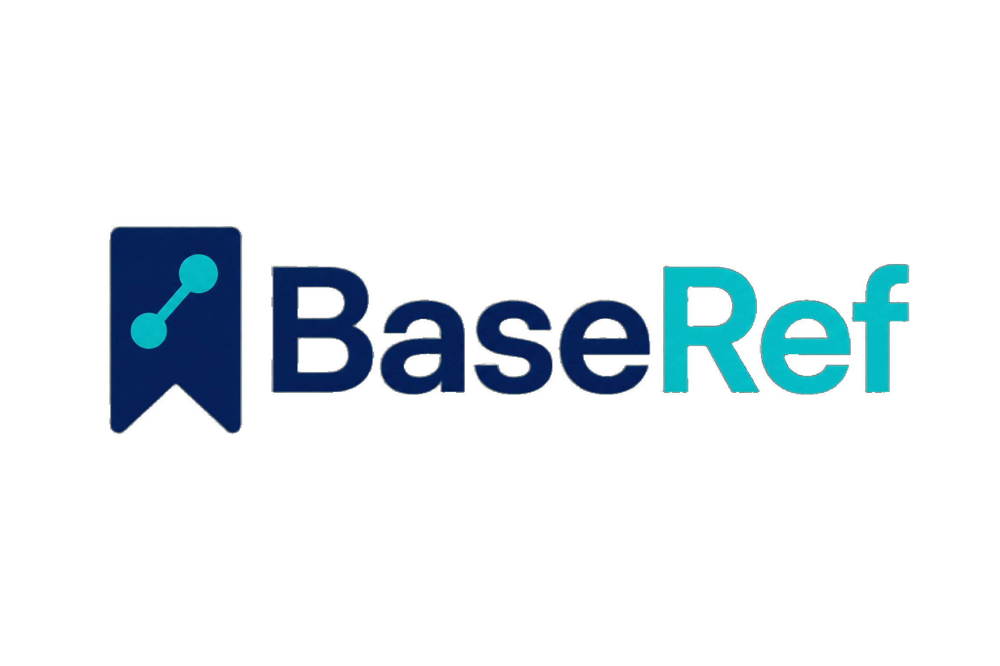

# BaseRef

**Open-source web system for managing Systematic Literature Reviews** based on the **PRISMA 2020** protocol.



## Features

- **Projects** — Manage multiple reviews simultaneously
- **Import** — Supports `.bib` (BibTeX), `.ris`, PubMed XML, and Scopus CSV files from Scopus and Web of Science
- **Deduplication** — Automatic duplicate detection by DOI and title similarity
- **Screening** — Title/abstract assessment with include/exclude decisions and configurable exclusion reasons
- **Eligibility** — Full-text assessment
- **Multi-reviewer agreement** — Dual-blind screening mode with Cohen's kappa and consensus resolution for disagreements
- **AI-assisted screening** — Optional include/exclude/uncertain suggestions (Groq, Gemini, or Anthropic) to support — never replace — the human reviewer's decision
- **OpenAlex enrichment** — Fills missing abstracts, citation counts, and open-access status from imported DOIs
- **PRISMA 2020 diagram** — Automatically generated with PNG/SVG export
- **Bibliometrics** — 30+ charts and networks (Lotka's and Bradford's laws, co-authorship, keyword co-occurrence, thematic maps, country collaboration, h/g/m indices, and more), filterable by dataset and exportable to XLSX per chart
- **PICO(C) extraction** — Structured data extraction for included studies
- **Quality/risk-of-bias assessment** — CASP, JBI, or a custom instrument
- **Export** — CSV, BibTeX, and JSON for every scope
- **PRISMA 2020 checklist** — 27 items to ensure reporting compliance
- **Admin panel** — Usage overview and "view as user" support for troubleshooting

## Technology

- **Backend**: PHP 8+ / MySQL
- **Frontend**: HTML5, CSS3, JavaScript (no framework)
- **Charts**: Chart.js 4, vis.js 9, D3.js, wordcloud2.js
- **Local server**: MAMP (macOS/Windows), XAMPP, or any PHP+MySQL server

## Installation (MAMP)

### Requirements
- [MAMP](https://www.mamp.info/) installed and running
- PHP 8.0+ and MySQL 8.0+

### Steps

1. **Clone the repository** into MAMP's `htdocs` folder:
   ```bash
   cd /Applications/MAMP/htdocs
   git clone https://github.com/rafaelgross/baseref.git
   cd baseref
   ```

2. **Configure the database** in `config/database.php` (copy `config/database.example.php` and fill in your own values):
   ```php
   define('DB_HOST', '127.0.0.1');
   define('DB_PORT', '8889');      // MAMP default = 8889
   define('DB_NAME', 'baseref');
   define('DB_USER', 'root');
   define('DB_PASS', 'root');
   ```

3. **Create the database** via phpMyAdmin (MAMP → Open WebStart → phpMyAdmin):
   - Create the `baseref` database (charset: `utf8mb4`)
   - Import the `sql/schema.sql` file

   **Or via terminal:**
   ```bash
   /Applications/MAMP/Library/bin/mysql -u root -proot -P 8889 -h 127.0.0.1 \
     -e "CREATE DATABASE IF NOT EXISTS baseref CHARACTER SET utf8mb4 COLLATE utf8mb4_unicode_ci;"
   /Applications/MAMP/Library/bin/mysql -u root -proot -P 8889 -h 127.0.0.1 baseref \
     < sql/schema.sql
   ```

4. **Configure Google OAuth** in `config/auth.php` (copy `config/auth.example.php`) with your own Google Client ID/Secret.

5. **Open in your browser:**
   ```
   http://localhost:8888/baseref/
   ```
   > MAMP's default port is 8888. Adjust as needed for your setup.

## Installation (XAMPP / other)

Configure `config/database.php` with:
```php
define('DB_PORT', '3306');    // default MySQL port
define('DB_USER', 'root');    // or your own user
define('DB_PASS', '');        // or your own password
```

## Basic Usage

1. **Create a project** → Projects → New Project
2. **Import references** → Import → drop `.bib`/`.ris`/`.xml`/`.csv` files from Scopus, Web of Science, or PubMed
3. **Deduplicate** → Duplicates → Detect (adjust the threshold if needed)
4. **Screening** → Screening → assess title/abstract article by article
5. **Eligibility** → Eligibility → assess full text
6. **View results** → PRISMA Diagram / Bibliometrics
7. **Export** → Export → CSV, BibTeX, or JSON
8. **Checklist** → PRISMA 2020 Checklist → 27 items for the report

## Supported Formats

### Scopus (`.bib` or `.csv`)
- Fields: `EID`, `affiliations`, `author_keywords`, `note` (cited by), `source`
- Auto-detected by default

### Web of Science (`.bib`)
- Fields: `Unique-ID`, `Times-Cited`, `Keywords-Plus`, `Affiliation`, `Web-of-Science-Index`
- Auto-detected by default

### PubMed (`.xml`)
- Standard PubMed/MEDLINE XML export

## Project Structure

```
baseref/
├── api/               # REST endpoints (PHP)
│   ├── projects.php
│   ├── import.php
│   ├── articles.php
│   ├── duplicates.php
│   ├── screening.php
│   ├── kappa.php
│   ├── prisma-flow.php
│   ├── bibliometrics.php
│   └── export.php
├── assets/
│   ├── css/style.css  # Complete design system
│   ├── js/            # Scripts
│   └── img/           # Images
├── config/
│   └── database.example.php  # Database configuration template
├── lib/
│   └── BibTexParser.php  # Custom BibTeX/RIS/XML/CSV parsers
├── pages/             # PHP pages (included via index.php)
├── sql/
│   └── schema.sql     # Database schema
└── index.php          # Main router
```

## License

MIT © 2024 — See [LICENSE](LICENSE)

## Citation

If you use this software in your research, please cite:

```
BaseRef: Open-source web system for managing Systematic Literature Reviews.
GitHub: https://github.com/rafaelgross/baseref
```

---

Built to support researchers conducting systematic literature reviews in accordance with the PRISMA 2020 protocol.
